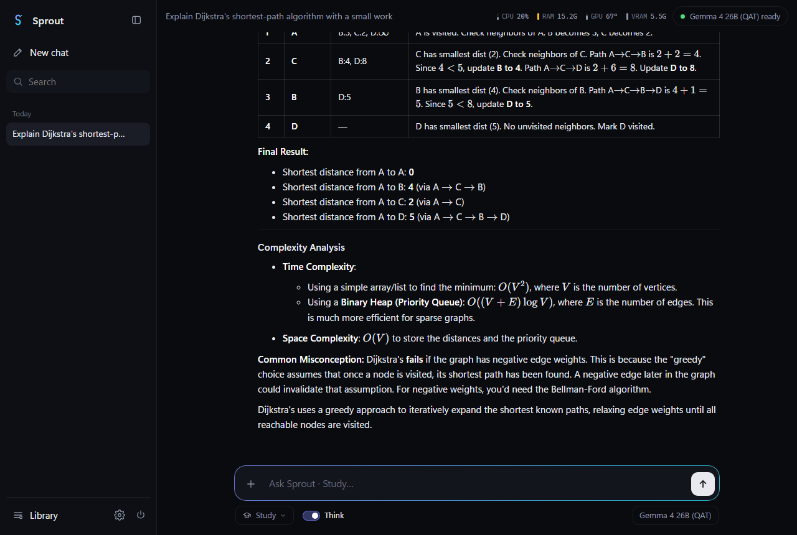
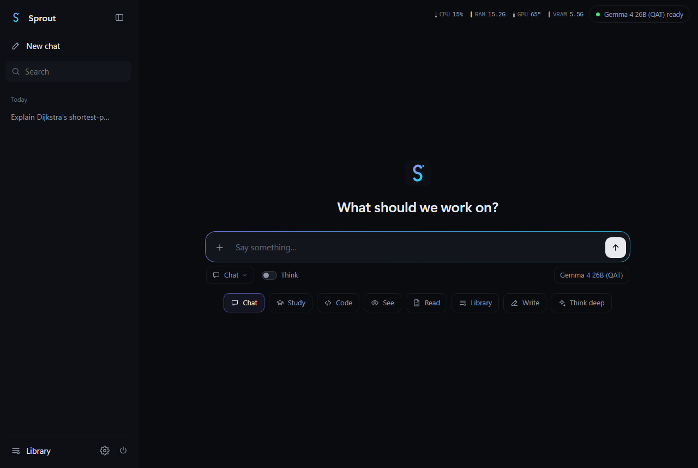

<p align="center">
  
</p>

<h1 align="center">SPROUT: big LLMs on a 6 GB laptop</h1>

<p align="center">
  A 26-billion-parameter model on an RTX 3050 laptop (6 GB VRAM, 16 GB RAM) at 12–35 tokens/s,<br>
  <b>without shrinking its intelligence</b>: every speed-up measured, every quality cost quantified,<br>
  and packaged as <b>Sprout</b>, a private, offline desktop AI.
</p>

<p align="center">
  <a href="https://github.com/hrithik-sp/SPROUT-big-llm-on-6gb-laptop/actions/workflows/tests.yml"></a>
  
  
  
  
</p>

<p align="center"><b>v1.1.0</b>: Sprout now knows the time, your location and your devices, works as your
assistant, and answers in 1.5–2.5 s. <a href="CHANGELOG.md">What's new</a></p>

<p align="center">
  
</p>

## The question

Can a mid-range laptop run a large modern language model **as intelligent as the released
version**? The usual answer, shrinking the model to 2–3 bits until it fits, measurably changes
what it says. This project took the strict route on one real laptop (RTX 3050 6 GB laptop GPU,
Ryzen 7 7840HS, 16 GB RAM, Windows 11):
- run models at the precision their makers **released** them;
- speed them up only with **output-preserving** methods;
- **measure** everything under controlled conditions against a computed physical ceiling.

## Results

<picture>
  <source media="(prefers-color-scheme: dark)" srcset="docs/images/tradeoff-dark.svg">
  
</picture>

| Model, as it runs here | MMLU-Pro (210 q) | Speed | Fidelity to the released model |
|---|---|---|---|
| **Gemma 4 26B-A4B Q8_0**: 26.9 GB, more than the RAM, streamed from the SSD | **83.8%** | 12.0 tok/s | Near-lossless (8.5 bits per weight) |
| **Gemma 4 26B-A4B QAT** (Google, 4-bit-trained) + its MTP draft head | 79.0% | **31–35 tok/s** | Small measured cost: −4.8 pts vs Q8_0, p = 0.041 |
| **gpt-oss-20b**, OpenAI's released MXFP4 | 70.5% | 27.7 tok/s | Identical: nothing shrunk |

~25 tok/s is faster than you can read. All runs used AC power and Windows' Best performance
mode; the full conditions and every raw number are in the [lab notebook](docs/LAB_NOTEBOOK.md).

## What made the difference

1. **llama.cpp's defaults and Windows' power settings left about a quarter of the speed
   unused.** On Windows, mmap keeps GPU-copied weights in RAM and forces SSD paging, and the
   1 GiB VRAM safety margin is a sixth of a small card. Windows also ran "Best power
   efficiency" while plugged in. Fixing all three made gpt-oss 34% faster with identical
   output.
2. **"Released at 4 bits" isn't the same as "lossless".** Google's 4-bit-trained Gemma 4 QAT
   scores 4.8 MMLU-Pro points below the near-lossless version (p = 0.041), a third of that
   from failing to finish hard questions. Its predictions differ from the original's as much
   as a 2-bit quantization's do. Because QAT is a re-trained model, not a compressed copy, only
   task accuracy can judge it.
3. **Speculative decoding depends on the model.** Gemma's own MTP head gives 1.32×. gpt-oss's
   EAGLE-3 draft makes it 22% *slower*, because checking several tokens loads the union of
   their experts, and many sit in RAM.
4. **Threads follow where the weights live:** 16 threads speed up SSD streaming by 21%, but
   slow RAM-resident gpt-oss by 10%.
5. **The standard quality metric breaks for chat models.** Gemma 4 instruct has a wikitext
   perplexity of ~19,000, and llama.cpp's KL-divergence tool silently clips its reference.
   Fidelity was measured on an in-distribution chat corpus instead, plus MMLU-Pro with exact
   sign tests.
6. **Gemma 4 is the more intelligent choice here:** +8.6 MMLU-Pro points over gpt-oss
   (p = 0.0096), even when only questions both models finished are counted.

### The analysis at a glance

<table>
<tr>
<td width="50%"><a href="REPORT.md#52-where-the-intelligence-gap-is"><picture><source media="(prefers-color-scheme: dark)" srcset="docs/images/subjects-dark.svg"></picture></a></td>
<td width="50%"><a href="REPORT.md#53-how-close-each-version-stays-to-the-original"><picture><source media="(prefers-color-scheme: dark)" srcset="docs/images/fidelity-dark.svg"></picture></a></td>
</tr>
<tr>
<td><a href="REPORT.md#54-what-made-it-faster"><picture><source media="(prefers-color-scheme: dark)" srcset="docs/images/speculative-dark.svg"></picture></a></td>
<td><a href="REPORT.md#54-what-made-it-faster"><picture><source media="(prefers-color-scheme: dark)" srcset="docs/images/threads-dark.svg"></picture></a></td>
</tr>
<tr>
<td><a href="REPORT.md#55-real-use-long-documents-and-other-apps"><picture><source media="(prefers-color-scheme: dark)" srcset="docs/images/ram-pressure-dark.svg"></picture></a></td>
<td><a href="REPORT.md#55-real-use-long-documents-and-other-apps"><picture><source media="(prefers-color-scheme: dark)" srcset="docs/images/long-context-dark.svg"></picture></a></td>
</tr>
</table>

The full story, including the wrong turns and how each was caught, is in
**[REPORT.md](REPORT.md)**: the journey, every comparison explained, and 35 problems with how
each was solved.

## Sprout



A one-click desktop app built on these results:
- **8 modes:** Chat, Study, Code, See (images), Read (PDFs), Library (your files, with
  citations), Write, and Think deep.
- **Offline and private:** everything runs on the laptop; it binds to localhost with
  per-server keys.
- **Light:** it starts hidden, uses 177 MB without a model, opens in ~0.1 s with
  `Ctrl+Alt+Space`, and frees the model after 10 idle minutes.
- **Knows your laptop:** the time, where you are, battery health, screen, sound, Bluetooth,
  files and apps, read-only, with a permission card for every call and secret locations
  blocked.

→ **[Sprout guide: features, install, security model](docs/SPROUT.md)**

<br clear="right">

## What's in this repository

| Path | Contents |
|---|---|
| [`REPORT.md`](REPORT.md) | The project report: goal, method, journey, results, problems and fixes |
| [`CHANGELOG.md`](CHANGELOG.md) | What changed in each version |
| [`docs/LAB_NOTEBOOK.md`](docs/LAB_NOTEBOOK.md) | Every measurement, with run tags, sources and reproduction commands (57 findings) |
| [`docs/SPROUT.md`](docs/SPROUT.md) | The app: features, architecture, security, install |
| [`docs/GLOSSARY.md`](docs/GLOSSARY.md) | The terms explained for students |
| `tools/` | Preflight memory check and roofline, benchmark harness with validity rules, quality and accuracy evaluation, figure generator |
| `app/` | Sprout (Python backend, HTML/JS UI, Windows integration) |
| `tests/` | 68 unit tests |
| `patches/` | Two small llama.cpp patches (llama-bench MoE cache option; chat-corpus perplexity) |
| `results/` | Raw logs of every run (JSON lines) and model-file hashes |

## Quick start

```powershell
pip install -r requirements.txt
python -m unittest discover tests          # 68 tests, no GPU or models needed
```

- **Run Sprout:** build llama.cpp, download the five model files, run `app\install.ps1`.
  Step by step: [docs/SPROUT.md](docs/SPROUT.md#install-windows-11--nvidia-gpu).
- **Reproduce a measurement:** every command checks first that the laptop can take it.
  See [Reproduce from scratch](docs/LAB_NOTEBOOK.md#reproduce-from-scratch).

## Limitations

Everything was measured on one laptop. The methods carry over; the numbers don't. Other
limits:
- 210 MMLU-Pro questions detect gaps of about 6 points.
- The reference is Q8_0, because the 50 GB BF16 model can't run here.
- Sprout hasn't had an independent security review.

Open items (light models for heavy multitasking, a large MoE-cache test) are listed in
[REPORT.md § 6–7](REPORT.md#6-limitations).

## Roadmap

Sprout's goal is a smart, human-feeling assistant that knows this laptop and, step by step, can
run it. Next, in order:

1. **Act on the laptop, with approval.** Open a file, folder or app; set volume or brightness;
   take a screenshot; close a frozen app. Every action shows a card first (like the read tools
   today), and nothing is deleted or sent.
2. **Optimise the laptop on request.** Find what slows it down (startup apps, memory hogs, full
   disks, battery wear), explain it plainly, and, with approval, apply the fix.
3. **A faster first reply.** Keep the model ready longer when memory allows, or prefetch it from
   the SSD, so the first message after a break isn't ~40 s.
4. **Memory you control.** Remember preferences and facts you tell it, stored locally,
   viewable and deletable.
5. **See the screen.** "What am I looking at?" through the vision model, with permission.
6. **A light mode for heavy multitasking:** a smaller model when Chrome and other apps need the
   RAM (Gemma 4 E4B/12B QAT and Qwen3.5-9B evaluation in progress).

Every step is measured with the same behaviour and laptop tests before it ships.

## Author

**Hrithik S P**: the research, measurements, tools, the Sprout app and the write-up.

Built on [llama.cpp](https://github.com/ggml-org/llama.cpp), Google's Gemma 4, OpenAI's
gpt-oss, and GGUF files from ggml-org and unsloth. The models are downloaded separately and
come under their own licences.

## Citation and licence

If this work helps you, please cite it. GitHub's "Cite this repository" button uses
[`CITATION.cff`](CITATION.cff).
- **Code:** [MIT licence](LICENSE).
- **Writing and figures:** README, REPORT, `docs/` and the charts are under
  [CC BY 4.0](LICENSE-DOCS). Reuse them freely, with credit to Hrithik S P and a link here.
- **Third-party parts** keep their own licences ([NOTICE](NOTICE)).
