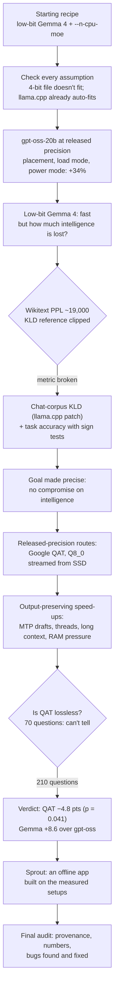
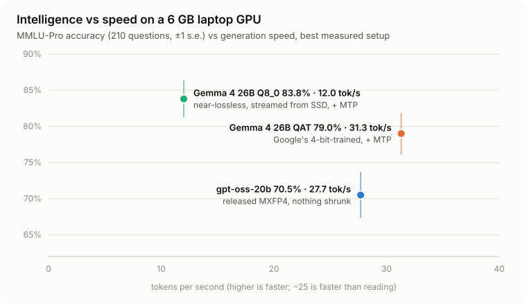
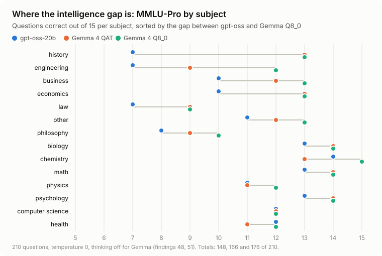
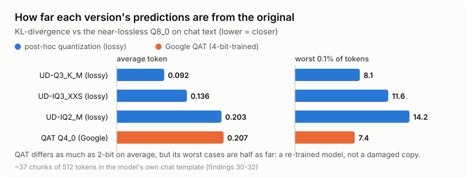
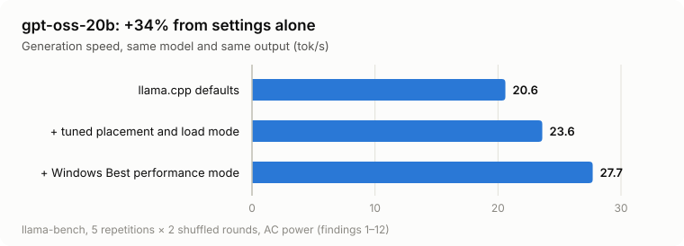
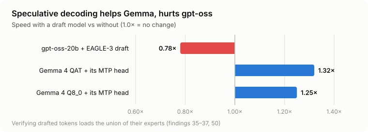
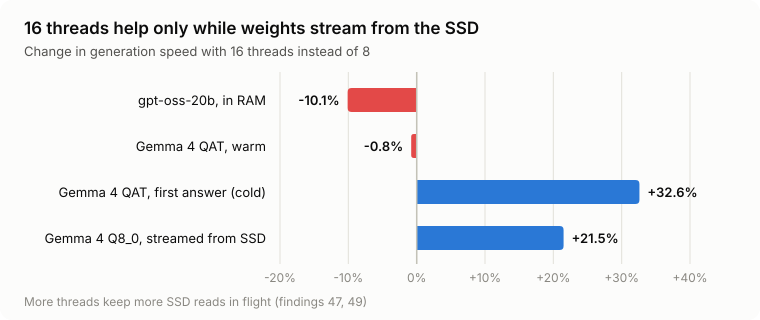
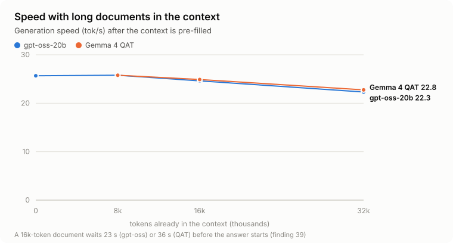
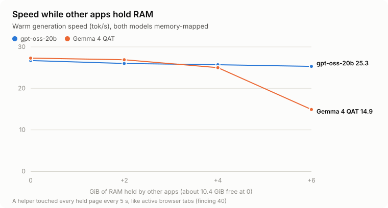

# Running big language models on a 6 GB laptop without losing intelligence

**Project report** · Hrithik S P

*Raw data: `results/*.jsonl`. Every measurement with its run tag: [docs/LAB_NOTEBOOK.md](docs/LAB_NOTEBOOK.md),
cited below as "finding N". Plain-language terms: [docs/GLOSSARY.md](docs/GLOSSARY.md).*

---

## Abstract

Can a laptop with a 6 GB GPU and 16 GB of RAM run a large, modern language model **without
making it less intelligent**? The usual answer is to shrink the model until it fits (2- or
3-bit quantization) and call it "close enough". I set a stricter goal: the model must match
its released version within measurement noise, every speed-up must preserve the output, and
every claim must be measured on the actual laptop under controlled conditions.

Using llama.cpp on an RTX 3050 laptop (Ryzen 7 7840HS, 16 GB RAM), I established three setups:
- **gpt-oss-20b**, exactly as OpenAI released it, at **27.7 tokens/s**: 34% faster than with
  llama.cpp's defaults, from settings alone;
- **Gemma 4 26B-A4B Q8_0**, near-lossless and bigger than the laptop's RAM, streamed from the
  SSD at **12.0 tokens/s**;
- **Gemma 4 26B-A4B QAT**, Google's 4-bit-trained release, at **31–35 tokens/s** with its own
  draft head.

On 210 MMLU-Pro questions the near-lossless Gemma scores **83.8%**, the QAT version **79.0%**
(a small but statistically real loss, p = 0.041), and gpt-oss **70.5%**.

Along the way I found:
- why llama.cpp's defaults, together with Windows' power settings, leave about a quarter of
  the speed unused on small machines;
- that the standard quality metric (wikitext perplexity and KL-divergence) silently breaks
  for instruction-tuned Gemma;
- that speculative decoding speeds Gemma up but *slows* gpt-oss down;
- a security flaw in llama-server's router mode.

I packaged the results as **Sprout**, a private, offline desktop AI app.

---

## 1. Author and acknowledgements

**Author:** Hrithik S P.

**Built on:**
- [llama.cpp](https://github.com/ggml-org/llama.cpp) (ggml-org);
- models by Google (Gemma 4, EmbeddingGemma 2) and OpenAI (gpt-oss), with GGUF conversions by
  ggml-org and unsloth;
- MMLU-Pro (TIGER-Lab) and GSM8K (OpenAI);
- marked, DOMPurify, KaTeX and highlight.js in the app.

---

## 2. The problem

A language model generates text one token at a time, and **for each token it must read every
weight it uses from memory.** On a laptop, speed is therefore set by memory *bandwidth*, not by
compute. I measured this machine's memory first (`tools/bandwidth.py`):

| Memory | Size | Read speed |
|---|---|---|
| GPU VRAM | 6 GB (~5.7 GiB usable) | 162 GB/s |
| System RAM | 16 GB (5–11 GB free in daily use) | 54 GB/s |
| PCIe, RAM → GPU | — | 13 GB/s |
| NVMe SSD | 954 GB | slowest tier (not measured separately) |

The models I studied are **mixture-of-experts (MoE)** models. Gemma 4 26B-A4B has 25 billion
weights, with 128 "experts" per layer, but only 8 experts run per token: about 3.8 billion
active weights. That is what makes a big model plausible here: only the *active* weights are
read per token. The engineering question becomes **where each tensor lives** (VRAM, RAM or SSD)
so that the bytes read per token come from the fastest memory possible.

From those bytes and bandwidths, my preflight tool (`tools/preflight.py`) computes a hard
ceiling, a *roofline*, for every configuration before it runs. Every result is reported as a
share of that ceiling, so no claim can exceed physics.

**Why "no quality loss" is hard.** The usual way to fit is to quantize the weights to fewer bits.
At 2–3 bits Gemma 4 fits easily, but its predictions shift measurably (section 5.3). So I looked
for **released-precision** models, whose weights the vendor ships at low precision and trained
for it. I treated lossy quantizations only as measured comparisons, never as the answer.

---

## 3. Method: the rules that keep the results honest

I set these rules at the start and enforced them in code (`tools/bench.py`, `tools/preflight.py`):

1. **Preflight before every run.**
   - Each configuration is checked against the VRAM and RAM free *at that moment*, using
     llama.cpp's own measured buffer sizes (`llama-fit-params --fit-print`).
   - A 1 GiB RAM safety margin protects the other apps.
   - Runs that don't fit are skipped and recorded as skipped. The margin was never loosened
     without written evidence.
2. **Speed with controls.** I used `llama-bench` with at least 5 repetitions (mean ± sd),
   configurations in shuffled order over 2 rounds, a GPU cool-down gate between tests, and the
   GPU temperature and clock logged.
3. **Validity checks.** A run is invalid if:
   - SSD reads during its timed part could explain more than 2% of the weight bytes it needed
     (it was paging, not computing);
   - the laptop left AC power (on battery, Windows caps the GPU at ~30 W).

   Invalid runs stay in the log, marked; none are silently dropped.
4. **Quality against the strongest reference that runs here.** The tools are:
   - KL-divergence of next-token predictions against Q8_0;
   - task accuracy with an **exact sign test** on paired answers;
   - flip counts, which are not enough alone, because compressed models can keep accuracy while
     many answers change (Dutta et al., NeurIPS 2024).
5. **Sources.** Every claim cites:
   - llama.cpp source code (verified in the cloned tree);
   - vendor documentation, a peer-reviewed paper, or my own measurement.

   Preprints and blogs are labelled as such.
6. **Provenance.**
   - All 11 model files match Hugging Face's published SHA-256 at pinned revisions.
   - llama.cpp is pinned to commit `0a1ef309c`, and its CUDA kernels pass all 18,762 backend
     operation tests against the CPU reference.
   - Both patches apply cleanly to that commit.

---

## 4. The journey

The project started from a common recipe: "take Gemma 4 26B-A4B at a low-bit quantization, tune
`--n-cpu-moe`, compare against ik_llama.cpp". It ended somewhere quite different. The map below
shows the path, including the turns where a measurement forced a change of direction.

### Step 1: check the starting assumptions

Before tuning anything, I checked every claim in the starting notes (lab notebook, "Review of the
starting research notes"):
- The suggested 4-bit Gemma file is **16.9 GB** and doesn't fit RAM + VRAM.
- A paper presented as tested on "nearly this hardware" used a GPU with **twice this one's memory
  bandwidth**.
- llama.cpp **already auto-fits** layers to the GPU by default, so the baseline to beat is the
  default, not naive flags.

Then I built llama.cpp for this exact CPU and GPU. AVX-512 VNNI/VBMI is on, and BF16 is off
because the compiler lacks it. I ran the full backend test suite (18,762/18,762 passed) and
confirmed that NVIDIA's silent "sysmem fallback" is off, so running out of memory fails loudly
instead of quietly slowing down.

### Step 2: make gpt-oss-20b fast without touching it

gpt-oss-20b ships at MXFP4, its released precision, so running it unchanged *is* lossless. All the
work was placement and system settings (findings 1–18):
- **mmap was the wrong default here** (finding 1). On Windows, memory-mapped weights that were
  already copied to the GPU stay mapped in RAM. Free RAM fell to 0.4 GiB, and CPU-side experts
  were re-read from the SSD. Loading without mmap (`-lm none`) gave +38–102% prompt speed and
  +4–7% decode, and kept 2–3 GiB free. The issue is known upstream (#18949, closed "not
  planned"); I measured what it costs on a 16 GB machine.
- **The 1 GiB VRAM safety margin wastes about a sixth of the usable 5.7 GiB** (finding 2):
  `-fitt 256` fits two more layers of experts.
- **One thread per physical core** (`-t 8`) is 20–25% faster than 6.
- **Windows' power mode was silently "Best power efficiency" while plugged in** (finding 12).
  Best performance added 16% to decode.
- **Ruled out by measurement:**
  - a clang build: no effect (finding 14);
  - thread pinning: −12% (finding 15);
  - process priority: none;
  - lowering the GPU-offload threshold for short prompts: refuted, since the CPU manages only
    ~72 tok/s of prompt processing (finding 16).

Mistakes I caught and corrected along the way:
- A batch-size sweep ran each decode test right after a hot prompt test, so heat made the smaller
  batch look slower, against physics. Decode is now always measured in its own run (findings 6, 9).
- One sweep throttled at 87 °C and was excluded.
- The laptop slipped onto battery during one run. That run is excluded, and the harness now
  refuses to start on battery.

### Step 3: low-bit Gemma 4, and a quality metric that lied

I downloaded and verified three low-bit quantizations of Gemma 4 (IQ2_M, IQ3_XXS, Q3_K_M) plus
the near-lossless Q8_0 as the reference. The low-bit versions decode at 25–30 tok/s (finding 20),
as fast as gpt-oss for a far stronger model. Then the quality measurement broke:
- **Wikitext perplexity of Gemma 4 instruct was ~19,000** (finding 22). The model wasn't broken:
  two files agreed, and it answered questions correctly. It is a chat model, and raw Wikipedia
  text is far outside what it was trained to see.
- **The KL-divergence tool silently clipped the reference.** Reading `perplexity.cpp` showed it
  stores only a 16-nat window below the top prediction. With this model's average loss of ~9.9
  nats, many true tokens fell outside it.
  - The tool's own "PPL(base)" read 7,342 against 18,883 from the base run. That mismatch is now
    my sanity check: for gpt-oss the two matched, 386.91 vs 386.95.
- **My fix:** an **in-distribution chat corpus**, made of the model's own answers rendered with
  its chat template.
  - This needed a small llama.cpp patch so `llama-perplexity` reads chat markers as special
    tokens (`patches/llama-perplexity-parse-special.patch`).
  - On that corpus the reference perplexity is a sane 2.96, and the KLD numbers are meaningful
    (findings 30–32).

Two more instruments failed and were replaced:
- Word-for-word answer agreement was too strict: every version diverges within a few hundred
  characters, at the first near-tie (finding 23).
- GSM8K maths with thinking on mostly measured the token budget (finding 25). With thinking off,
  every version scored 49 or 50 out of 50 (finding 26), a ceiling.

That led to MMLU-Pro.

### Step 4: making the goal precise

At this point I fixed the goal: **run a big model with small system resources without
compromising its intelligence or perplexity.** It became the success criterion at the top of
every document, and it changed the plan:
- Low-bit quantizations stopped being candidates and became measured comparisons.
- I turned to **released-precision** routes:
  - Google's **Gemma 4 QAT Q4_0**, trained with 4-bit weights in the loop, which Google says
    keeps "similar quality to bfloat16";
  - running the **near-lossless Q8_0** (26.9 GB, more than the laptop's RAM) by streaming it
    from the SSD, and making that fast.

A literature search (lab notebook, "Research for the goal") pointed to the main remaining
lossless lever: **speculative decoding**, which pays most when weights stream. It also pointed to
its known caveat for MoE models.

### Step 5: speed without changing the answer

- **Gemma 4 QAT** (13.45 GiB) is about 0.75 GiB too big to sit fully in RAM here. It runs
  memory-mapped while the OS keeps the hot experts cached: about 15 tok/s on the first answer,
  while experts load from the SSD, then **27–29 tok/s warm** (finding 28).
- **Speculative decoding** lets a small draft guess several tokens, and the big model checks them
  all in one pass. I swept draft lengths for each model against a baseline measured before and
  after (findings 35–37, 42). Results are in section 5.4.
- **Its quality, checked directly:** speculative decoding in llama.cpp is not bit-identical,
  because batched verification rounds differently and near-tie words can flip (finding 36).
  - On MMLU-Pro, QAT with the draft scored 82.9% against 81.4% without (p = 1.0).
  - The same experiment gave a **noise floor**: rounding alone changes 4 of 70 final answers
    (finding 36b). Counting flipped answers between two models therefore overstates real
    differences, and accuracy with a paired test is the right verdict.
- **Thread count:** I measured it for each model separately instead of assuming one setting fits
  all (findings 47, 49; section 5.4).

### Step 6: does it survive real use?

A benchmark on an idle laptop is not daily use. I measured two things that matter on a
student's laptop (section 5.5):
- **long documents:** decode speed with 8k–32k tokens already in the context, and the wait
  before the answer starts (finding 39);
- **other apps holding RAM:** a helper program held 0, 2, 4 or 6 GiB and touched every page every
  5 seconds, like active browser tabs (finding 40).

### Step 7: the verdict on intelligence

I used MMLU-Pro (TIGER-Lab, 14 subjects) with a stratified fixed sample, temperature 0, thinking
off and a 4,096-token answer budget. An answer still cut off at that budget counts as wrong.
- **70 questions weren't enough:** QAT was 4 points below Q8_0 at p = 0.45, and 70 questions
  only detect gaps of about 10 points (finding 33).
- So I extended the sample to **210 questions**, 15 per subject. The 70 are a prefix of the 210
  (verified), so no question ran twice (finding 48).
- I then ran gpt-oss on the same 210 to decide which model Sprout should use (finding 51).

The results and their analysis are in sections 5.1–5.3.

### Step 8: Sprout, the app

I turned the measured setups into Sprout, a one-click offline desktop app. Its design principles:
- **Behaviour:**
  - a human texting style without emoji, and not a messenger clone;
  - calm and futuristic rather than organic or cluttered;
  - subtle motion only while working, no blinking caret, and tiny live vitals.
- **Access:** read-only laptop access with per-call permission.
- **Personal:** the model knows who it works for, and there is no extra content filter.

The details are in [docs/SPROUT.md](docs/SPROUT.md). Engineering problems I found and fixed:
- **llama-server's router mode strips the API key** from the model servers it starts
  (`unset_reserved_args` in `server-models.cpp`, finding 44). With CORS open to every origin, any
  web page in the browser could have used the local model. Sprout manages its own keyed servers,
  and a unit test enforces it.
- **llama-server's default 8 GiB prompt cache** would push Gemma's experts out of RAM. I capped it
  at 1 GiB (finding 41).
- **Tool results were cut at 6,000 characters,** so the model miscounted a file it could only
  half see. The cap is now 24,000 (finding 45).
- **Ending Microsoft Edge killed Sprout** (found using Task Manager): the app window was an Edge
  app window. Sprout now has its own WebView2 window, shown in ~0.1 s and using 177 MB with no
  model loaded (finding 52).
- **A hidden window woke the model in the background.** Fixed and tested: no model loads until the
  window is shown.
- **It invented facts it couldn't see.** Asked the time, it made one up; asked the screen
  resolution, it guessed. I gave every request the live clock, added location and device tools,
  and a rule against guessing. Ten everyday laptop questions went from 3 to 10 answered
  correctly (finding 55).
- **It behaved like a chatty friend, not an assistant,** and fumbled games. A scripted
  behaviour test of eight conversations went from 3 to 8 passing (finding 56). The fixes:
  - a boss-and-assistant persona;
  - a final answer pass that can't come back empty;
  - one-call file search over the personal folders;
  - a game referee that the model is required to use;
  - short automatic reasoning for questions with numbers.
- **The live clock first broke prompt caching** (one line that changed every minute, at the top
  of the prompt): replies in a real chat took 12–16 s. With the clock moved to the newest message,
  a six-turn test re-processes only the new message and shows the first word in 2–3 s
  (finding 55).

### Step 9: final audit

Before publishing I re-audited everything:
- **Provenance:** model hashes re-verified, patches re-applied to a clean tree, requirements
  pinned, paths made portable.
- **Headline numbers** recomputed from the raw logs.
- **My own earlier claims, corrected:**
  - a "16 threads aren't faster" claim that hadn't been measured: removed, then measured (finding 49);
  - a double-counted gain;
  - a benchmark score attributed to the wrong source;
  - a cold-start gain recorded as +30% where the logs give +33%.
- **`-ub 2048`** had been recommended without a clean decode measurement. llama.cpp caps the
  batch at the context length, so a short decode test runs `-ub 512` and `-ub 2048` identically
  (finding 53). `bench.py` now warns about this. The fair test didn't fit the RAM safety margin,
  so the advice stays conditional.
- **A Sprout bug** surfaced while I was taking screenshots (finding 54). The RAM-aware model
  choice counted the loaded Gemma's own memory as "used", and would have swapped a working Gemma
  for gpt-oss on the next mode switch. Fixed, with regression tests.
- **The tests no longer depend on the GPU**, so they also run on machines without one (CI).
- **Licence hygiene:** DOMPurify's licence file was added after confirming the bundled file is
  byte-identical to the npm release.

---

## 5. Results and analysis

### 5.1 Intelligence vs speed

<picture>
  <source media="(prefers-color-scheme: dark)" srcset="docs/images/tradeoff-dark.svg">
  
</picture>

| Model, as it runs here | MMLU-Pro (210 q) | vs Q8_0 | Exact sign test | Speed |
|---|---|---|---|---|
| Gemma 4 26B **Q8_0** (near-lossless, from SSD) | **83.8% ± 2.5** | — | — | 12.0 tok/s |
| Gemma 4 26B **QAT Q4_0** (Google) | **79.0% ± 2.8** | −4.8 pts, 95% CI [−8.9, −0.6] | p = 0.041 | 31–35 tok/s |
| **gpt-oss-20b** (released MXFP4) | **70.5% ± 3.1** | −13.3 pts | p < 0.0001 | 27.7 tok/s |

- **No setup is best at everything.** The most intelligence (Q8_0) costs speed. The fastest
  high-capability option (QAT) costs 4.8 points. The model that is exactly as released (gpt-oss)
  is the weakest.
- **QAT's cost is small but real** (finding 48). About a third of it is QAT running past the
  4,096-token budget on the hardest chemistry and engineering questions. On the 199 questions
  both finished, the gap is 2.5 points (p = 0.30). This doesn't contradict Google's "similar
  quality to bfloat16" so much as quantify it on this test.
- **Against published scores,** the measurements agree within the 95% margin of a 210-question
  sample:
  - Gemma 4 26B-A4B: 82.6 on Google's model card vs 83.8% here (Q8_0);
  - gpt-oss-20b: 74.8 in Qwen's model-card comparison vs 70.5% ± 3.1 here.

### 5.2 Where the intelligence gap is

<picture>
  <source media="(prefers-color-scheme: dark)" srcset="docs/images/subjects-dark.svg">
  
</picture>

- **gpt-oss's deficit is knowledge, not reasoning.** It trails by 6 questions of 15 in history
  and 5 in engineering. It ties or nearly ties in maths, chemistry, physics and computer science.
- **The deficit isn't explained by the token budget:** gpt-oss ran out of tokens more often (19 vs
  11 cut-offs), but on the 187 questions both models finished it is still 6.5 points behind QAT
  (finding 51).
- **QAT loses to Q8_0 mostly in engineering (−3) and chemistry (−2)**, the subjects with the
  longest calculations, where it more often fails to finish.

### 5.3 How close each version stays to the original

<picture>
  <source media="(prefers-color-scheme: dark)" srcset="docs/images/fidelity-dark.svg">
  
</picture>

- **The lossy quantizations rank by bits**, as expected: Q3_K_M is closest to the original and
  IQ2_M farthest (finding 31).
- **QAT is as far from the original *on average* as the 2-bit IQ2_M** (0.207 vs 0.203), with 91.4%
  of next-token choices the same. **But its worst cases are about half as far** (99.9th percentile
  7.4 vs 14.2, maximum 11.8 vs 24.6).
- **The explanation:** QAT is a *re-trained* model that predicts differently across the board,
  not a damaged copy that occasionally breaks. That's why KL-divergence alone can't judge it,
  and why task accuracy (section 5.1) is the verdict.
- **Accuracy, compared:**
  - The lossy versions match on GSM8K: 49/50 with no answer flips vs Q8_0 (finding 26). GSM8K
    is at its ceiling, though.
  - On 70 MMLU-Pro questions, IQ2_M scored 88.6% (p = 0.73 vs Q8_0), which is noise at that
    sample size (finding 33). On those 70 questions it also produced 2 repetition loops; QAT
    and Q8_0 produced none.
  - The lossy versions were not run on all 210 questions, so no accuracy ranking against QAT is
    claimed.

### 5.4 What made it faster

<picture>
  <source media="(prefers-color-scheme: dark)" srcset="docs/images/gptoss-speedup-dark.svg">
  
</picture>

- **The same model and the same output, 34% faster.** Placement and load mode (no mmap, a
  smaller VRAM margin) give +15%. Windows' power mode, which had been throttling the CPU while
  plugged in, adds another 16% on top: the larger of the two steps.
- **Against the roofline,** the tuned setup reaches 71–72% of the hard bandwidth ceiling, up from
  57% with the defaults.
- **Against prior work:** the closest published study is ATSInfer (a preprint), which runs
  gpt-oss-20b on a 6 GB RTX 3060 laptop and reports 35–60 ms per token for llama.cpp. My tuned
  36 ms per token (27.7 tok/s) sits at the fast end of that range, on a GPU rated at about half
  that card's memory bandwidth.

<picture>
  <source media="(prefers-color-scheme: dark)" srcset="docs/images/speculative-dark.svg">
  
</picture>

- **Gemma's own MTP head: 1.32× for QAT** (34.9 tok/s, 81% of drafted tokens accepted). With
  Google's recommended sampling it is 1.25×, or 31.3 tok/s (finding 42).
- **gpt-oss with EAGLE-3: 0.78×, slower at every draft length.**
  - Checking 3 tokens needs the *union* of their experts, and many of gpt-oss's experts sit in
    RAM.
  - One verification step costs 2.5× a normal step but yields only ~2 tokens.
  - The literature warns this can happen with MoE models (Cascade, preprint); here it is
    measured.
- **Q8_0 streamed from the SSD: 1.25×.** When weights stream, checking extra tokens is nearly
  free, the effect SpecExec (NeurIPS 2024) describes.
- **Longer drafts lose** for the RAM-resident models: acceptance falls faster than the cost
  amortizes.

<picture>
  <source media="(prefers-color-scheme: dark)" srcset="docs/images/threads-dark.svg">
  
</picture>

- **Threads follow where the weights live.**
  - When weights stream from the SSD, the compute threads also serve the page faults, so more
    threads keep more reads in flight: +21.5% for Q8_0 and +33% for QAT's cold first answer.
  - When weights are already in RAM, the extra threads only compete for memory bandwidth:
    −10% for gpt-oss.
- **The best near-lossless setup combines both:** Q8_0 with 16 threads and its MTP head reaches
  12.0 tok/s, 1.38× its plain speed (finding 50).

### 5.5 Real use: long documents and other apps

<picture>
  <source media="(prefers-color-scheme: dark)" srcset="docs/images/long-context-dark.svg">
  
</picture>

- **Both goal models stay usable at long context:** decode at 32,000 tokens is ~13% slower than
  at 8,000, because attention reads the growing KV cache every token.
- **The wait before the answer starts:** a 16,000-token document (~12,000 words) takes 23 s
  (gpt-oss) or 36 s (QAT).

<picture>
  <source media="(prefers-color-scheme: dark)" srcset="docs/images/ram-pressure-dark.svg">
  
</picture>

- **gpt-oss is the multitasking-proof model:** only −5% with 6 GiB taken by other apps.
- **Gemma QAT holds up to +4 GiB, then falls off a cliff (−45%).** Its hot experts no longer fit
  in RAM and are re-read from the SSD every token (19 GB read in one test).
- **Fastest is not always best here:** `-lm none`, fastest when RAM is plentiful, is the most
  fragile under pressure. It doesn't fit at all with +4 GiB taken.
- **How Sprout uses this:** with less than 5.5 GiB free, it starts gpt-oss instead of Gemma.

### 5.6 Recommended setups (this laptop)

| Goal | Setup | Speed | MMLU-Pro |
|---|---|---|---|
| Most intelligence | Gemma 4 Q8_0, `-lm auto -t 16`, MTP draft n3 | 12.0 tok/s | 83.8% |
| Best balance (Sprout's default) | Gemma 4 QAT, `-lm auto -fitt 128 -t 16`, MTP draft n2 | 31–35 tok/s | 79.0% |
| Exactly as released, robust to RAM pressure | gpt-oss-20b, `-lm none -fitt 256 -t 8` | 27.7 tok/s | 70.5% |

Full commands: lab notebook, "Recommended settings".

### 5.7 Problems found and how I solved them

| # | Problem | How it showed up | Resolution | Finding |
|---|---|---|---|---|
| 1 | mmap keeps GPU-copied weights in RAM on Windows | RAM at 0.4 GiB, SSD paging | `-lm none` when the weights fit | 1 |
| 2 | 1 GiB fit margin wastes VRAM | Fewer experts on the GPU than possible | `-fitt 256` (128 for QAT) | 2 |
| 3 | Preflight overestimated Gemma's KV cache 4× | 1,680 vs 380 MiB | Implemented llama.cpp's sliding-window formula exactly | notebook, "Measured results" |
| 4 | Placement computed with a different batch size than the benchmark | A plan that would have overflowed VRAM | Always pass the same `-b`/`-ub` to fit and bench | method |
| 5 | Heat carried over between tests | Smaller batch "slower", against physics | Decode in its own runs; cool-down gate; shuffled rounds | 6, 9 |
| 6 | Laptop left AC mid-run | GPU capped at 30 W | Refuse to start on battery; invalidate on power loss | 13 |
| 7 | Antivirus scans inflate disk counters | Spurious "paging" | Validity uses each test's *share* of weight traffic | method |
| 8 | Wikitext PPL ~19,000 and a clipped KLD reference | PPL(base) 7,342 vs 18,883 | Chat-corpus KLD + llama.cpp patch; PPL(base) sanity check | 22, 30–32 |
| 9 | Word-for-word agreement too strict | 0/6 identical, all fine | Task accuracy with a paired sign test | 23 |
| 10 | Thinking mode exhausted the token budget | Half of GSM8K "wrong" | Thinking off for accuracy tests | 25 |
| 11 | GSM8K at ceiling, 70 MMLU-Pro questions underpowered | p = 0.45 | 210 questions (prefix-consistent extension) | 26, 33, 48 |
| 12 | Speculative decoding not bit-identical | Near-tie words flip | Measured accuracy; noise floor of 4/70 flips | 36, 36b |
| 13 | Windows paths broken by POSIX argument splitting | Server refused to start | `split_args` + tests | 38 |
| 14 | ik_llama.cpp computes gpt-oss differently | KLD 0.022, 9% top-token flips | Excluded from speed claims; cause isolated as far as possible | 19 |
| 15 | Small MoE cache thrashes | 0% hit rate, −62% | Recorded as a negative result; matches the break-even analysis | notebook, "MoE expert cache" |
| 16 | NVML PCIe counters exceed the link maximum | 25.6 GB/s on a 15.75 GB/s link | Not used as absolute throughput | 18 |
| 17 | PowerShell passed `0,2,4,6` as one string | A 246 GiB hold requested | Comma-string parameters, capped at 8 GiB | method |
| 18 | Router mode strips the API key | Unkeyed local model server | Sprout's own keyed engine + test | 44 |
| 19 | 8 GiB default prompt cache | Experts pushed out of RAM | Capped at 1 GiB | 41 |
| 20 | Tool results truncated | Model miscounted a file | Cap raised, tool guidance tightened | 45 |
| 21 | Sprout depended on Edge | Ending Edge closed Sprout | Native WebView2 window | 52 |
| 22 | Window test passed falsely | It captured the wrong window | Capture the window's own pixels (`PrintWindow`) | 52 |
| 23 | Batch size capped by context length | `-ub 2048` decode never really tested | Warning in `bench.py`; test at depth | 53 |
| 24 | RAM-aware default counted Sprout's own model | Gemma would swap itself out | Count own model as available + tests | 54 |
| 25 | A test read the real GPU | Would fail on machines without one | Fixed GPU reading in the test, plus a no-GPU case | final audit |
| 26 | Power cut during a measurement | One run on battery | Marked invalid, rerun on AC | 49 |
| 27 | Sprout invented the time and a screen resolution | Plausible but unsourced answers | Live clock with every request; location and device tools; no-guessing rule | 55 |
| 28 | A changing clock line at the top of the prompt | 12–16 s replies (cache re-processed) | Clock moved to the newest message; unit test keeps the prompt stable | 55 |
| 29 | A volume probe declared Windows' audio interface wrongly | One read called SetMute | Speakers restored; full interface in documented order, getters only | 55 |
| 30 | The tool loop could end with an empty reply | Answer blank after the last tool round | Final pass without tools | 56 |
| 31 | The model can't keep a secret word between turns | Contradictory Wordle feedback, wrong Hangman boards | A game referee in code; game moves require a tool call | 56 |
| 32 | Arithmetic answered without working | 4:40 or 4:50 stated instead of 4:35 in some runs | Automatic short reasoning (320-token budget) for questions that need it | 56 |

---

## 6. Limitations

- **One machine.** The methods carry over; the numbers don't. Speed depends on free RAM and heat.
- **Samples are finite.**
  - 210 MMLU-Pro questions detect gaps of about 6 points. "Not significant" means not
    *detectable*, not proven equal.
  - The QAT result (p = 0.041) is close to the line, and the sample was extended after a first
    look.
- **The reference is Q8_0, not BF16.** The 50 GB BF16 model can't run here.
- **Vendor and third-party scores** are quoted and labelled, not re-measured.
- **Sprout** is a personal tool without an independent security review.
- **Not done:**
  - the light-model study (partly run; no result claimed);
  - a large-MoE-cache test (needs ~10 GB free RAM);
  - `-ub 2048` decode at depth (blocked by the RAM margin);
  - Gemma with thinking on for hard reasoning.

## 7. Future work

- **Light models for heavy multitasking:** Gemma 4 E4B and 12B QAT, and Qwen3.5-9B, on the same
  210 questions.
- **Upstream contributions:**
  - the `--moe-cache-mib` option for llama-bench (patch and PR text in `patches/`);
  - notes on mmap and fit margins for small GPUs;
  - a report of the ik_llama.cpp divergence.
- **Expert prefetching and dynamic CPU-GPU scheduling** (HybriMoE, DAC 2025: 1.70× decode) is
  lossless but not in llama.cpp, and would be a substantial contribution.

## 8. Reproducing

Everything runs from this repository plus llama.cpp at `0a1ef309c`. The lab notebook's
[Reproduce from scratch](docs/LAB_NOTEBOOK.md#reproduce-from-scratch) lists the pinned model
revisions, the data, and the command behind each headline result. `python tools/make_figures.py`
regenerates every chart.

## References

- llama.cpp, ggml-org: source at `0a1ef309c`; PRs #29887, #30637 (MoE cache), #25794 (MTP);
  issue #18949 (mmap on Windows).
- Google, Gemma 4 model cards and the QAT release; OpenAI, gpt-oss model card.
- Dutta et al., *Accuracy is Not All You Need*, NeurIPS 2024.
- Svirschevski et al., *SpecExec*, NeurIPS 2024.
- *Utility-Driven Speculative Decoding for Mixture-of-Experts* (Cascade), arXiv 2506.20675
  (preprint).
- Kamahori et al., *Fiddler*, ICLR 2025.
- Cao et al., *MoE-Lightning*, ASPLOS 2025.
- Chen et al., *KTransformers*, SOSP 2025.
- *HybriMoE*, DAC 2025.
- Liu et al., *ATSInfer*, arXiv 2607.10183 (preprint): the closest prior work, gpt-oss-20b on a
  6 GB laptop GPU.
- Wang et al., *MMLU-Pro* (TIGER-Lab); Cobbe et al., *GSM8K* (OpenAI).

Full links: lab notebook, "Research findings", "Research for the goal" and "Related research".

---

*© 2026 Hrithik S P. This report and its figures are licensed under [CC BY 4.0](LICENSE-DOCS); the code is MIT ([LICENSE](LICENSE)).*
