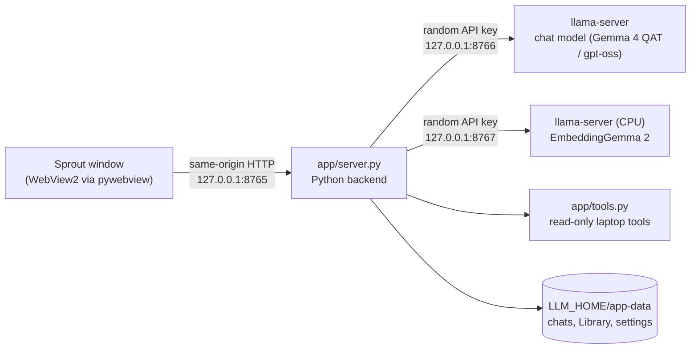

# Sprout: a private, offline AI for a 6 GB laptop

Sprout is a one-click desktop app that runs the setups measured in this project:
Google's Gemma 4 26B (QAT) at about 31 tok/s and OpenAI's gpt-oss-20b at its released
precision. Everything runs on the laptop. Nothing is sent anywhere, and the app works
with the network cable pulled.

<p align="center">
  
  
</p>

*Left: the home screen. Right: a real Study-mode answer (Gemma 4 QAT, 32.7 tok/s, captured
from a fresh test profile; the worked example was checked by hand).*

## What it does

| Mode | Model | For |
|---|---|---|
| **Chat** | Gemma 4 QAT | Your personal assistant over text: short, human replies, no emoji; thinks briefly on its own when a question needs working out; plays Wordle and Hangman with a real referee |
| **Study** | Gemma 4 QAT, thinking on | Step-by-step explanations, worked examples, quizzes one question at a time |
| **Code** | Gemma 4 QAT, thinking on | Write, explain and debug code; paste errors or screenshots |
| **See** | Gemma 4 QAT + vision | Screenshots, diagrams, photos of notes: description, exact text, fixes |
| **Read** | Gemma 4 QAT | Ask about an attached PDF, Word or text file (~45k characters); answers cite pages |
| **Library** | Gemma 4 QAT + EmbeddingGemma 2 | Ask across your own saved files, with numbered citations |
| **Write** | Gemma 4 QAT | Draft, rewrite, proofread, translate |
| **Think deep** | gpt-oss-20b, reasoning high | Hard maths, proofs, logic |

**Laptop integration:**
- `Ctrl+Alt+Space` summons Sprout from anywhere; it appears in about 0.1 s.
- **Ask Sprout** on any file's right-click menu in File Explorer.
- A screen-snip button, clipboard import (text, images, copied files) and drag and drop.
- Tiny live vitals (CPU, RAM, GPU temperature, VRAM) and a status panel with
  "Free memory now".

**It knows the time.** Every request carries the laptop's current date, time, time zone and
region, so "what time is it?" is answered from the clock, never guessed.

**Read-only laptop access, with permission.** When you ask about your laptop, the model can
call read-only tools: location (Windows location, named offline), device details (battery
health, display and brightness, volume, Bluetooth, USB, printers, startup apps, internet
connection, laptop model), system vitals and info, open browser tabs, running apps and processes,
installed apps, clipboard text, recent and recently opened files, and listing, searching and reading files
(text, PDF, Word). Every call shows a card with the exact path: **Allow once**, **Always
allow** or **Deny**.

## How it stays light

Sprout is designed to share a 16 GB laptop with your other apps (lab-notebook findings 40–42, 49, 52):
- **Resident but idle:** it starts with Windows hidden, with no model loaded (about 177 MB).
  Closing the window only hides it; the power button quits.
- **The model wakes when the window opens,** usually before you finish typing, and unloads
  itself after 10 idle minutes.
- **RAM-aware:** with less than 5.5 GiB free it uses gpt-oss, which copes better with
  memory pressure (finding 40). Memory held by Sprout's own model counts as available, so a
  loaded Gemma never swaps itself out (finding 54).
- **Bounded caches:** llama-server's prompt cache defaults to 8 GiB; Sprout caps it at 1 GiB
  (finding 41).
- **Fast by measurement:** Gemma uses its own MTP draft head (1.25× at Google's sampling
  settings) and 16 threads (a cold first answer is 33% faster). A conversation with an image
  switches to a vision preset automatically.

## Architecture



- **Backend** (`app/server.py`): Python standard library plus psutil, numpy, pypdf and Pillow.
  It starts one keyed `llama-server` per role and swaps chat presets by restarting that
  server, so only one chat model is in memory at a time. A Windows job object kills child
  servers if Python dies.
- **UI** (`app/static/`): plain HTML, CSS and JavaScript. Markdown, maths and code
  highlighting use vendored libraries (marked, DOMPurify, KaTeX, highlight.js), each verified
  against npm's checksum. There's no CDN and no network use.
- **Modes** (`app/modes.json`): one prompt and sampling preset per mode.

## Security model

Sprout is a personal tool, not a hardened product. It hasn't had an independent security
review. Its protections:
- **Local only:** every server binds to 127.0.0.1.
- **Keys and origin checks:** each llama-server has a random API key. llama-server allows
  every origin (CORS), so without the key any web page could call it. The backend refuses
  cross-origin requests and serves a strict Content-Security-Policy.
- **No router mode:** llama-server's router mode starts its model servers *without* the API
  key, so Sprout doesn't use it (finding 44; a unit test enforces this).
- **Read-only tools:** they can never write, delete, run programs, send anything or reach
  the network.
- **Blocked paths:** even with approval, `safe_path` refuses network and device paths, data
  streams, SSH/GPG/cloud keys, browser profiles (passwords, cookies, history), Windows
  credential stores, registry hives, password-manager vaults, crypto wallets, messenger
  data and `.env` files (unit-tested).
- **Untrusted file contents:** the model is told to treat file contents as data, not
  instructions.
- **No guessing:** the model is told never to state a laptop fact (time, place, hardware,
  settings, files) that isn't in a tool result; it calls the tool or says it can't see it.
- **Location** comes from Windows' own location service, and only when that is turned on
  (Settings > Privacy & security > Location). Sprout names the place from a built-in GeoNames
  list and sends nothing anywhere; Windows itself may use its network lookup to find the
  position.

**Content:** Sprout adds no extra content filter. Its prompts ask the models to answer frankly,
without moralising or disclaimers. The models' own safety training still applies. This was
the author's choice for a personal assistant; edit `UNCENSORED` in `app/server.py` for a
stricter style.

## Install (Windows 11 + NVIDIA GPU)

Tested on an RTX 3050 6 GB laptop GPU with 16 GB of RAM. You need about 27 GB of disk for
the models.

1. **Python 3.11:** `pip install -r requirements.txt`.
2. **llama.cpp:** build commit `0a1ef309c` with CUDA. See "Reproduce from scratch" in the
   [lab notebook](LAB_NOTEBOOK.md#reproduce-from-scratch). Sprout needs only `llama-server`;
   the two patches are for the research tools.
3. **Models:** download the five files below. Each download is checked against Hugging
   Face's SHA-256. Large files live in `LLM_HOME`, which defaults to `%USERPROFILE%\llm`.

   ```powershell
   $f = "tools\fetch_model.ps1"
   powershell -ExecutionPolicy Bypass -File $f google/gemma-4-26B-A4B-it-qat-q4_0-gguf gemma-4-26B_q4_0-it.gguf -Revision d1c082be9cf3c8a514acf63b8761f4b41935842e
   powershell -ExecutionPolicy Bypass -File $f google/gemma-4-26B-A4B-it-qat-q4_0-gguf gemma-4-26B-it-mmproj.gguf -Revision d1c082be9cf3c8a514acf63b8761f4b41935842e
   powershell -ExecutionPolicy Bypass -File $f unsloth/gemma-4-26B-A4B-it-qat-GGUF mtp-gemma-4-26B-A4B-it.gguf -Revision 7b92b5b28818151e8669af2e45e88d6086f490dd
   powershell -ExecutionPolicy Bypass -File $f ggml-org/gpt-oss-20b-GGUF gpt-oss-20b-MXFP4.gguf -Revision 15dcfc7e7c608c6161507211ed43c5b590801b4b
   powershell -ExecutionPolicy Bypass -File $f ggml-org/embeddinggemma-2-GGUF embeddinggemma-2-Q8_0.gguf -Revision 58faf90940886df2d62be555c8765d00dac362c5
   ```

   The models are not part of this repository and come under their own licences; see each
   model card.
4. **Install the shortcuts:** `powershell -ExecutionPolicy Bypass -File app\install.ps1`.
   This adds a desktop and Start-menu icon, a Startup entry (`--background`) and the
   Explorer menu, all for the current user only, with no admin rights.
   `app\uninstall.ps1` removes them.
5. Open **Sprout** and put your name in Settings, so it knows who it works for.

To run it without installing: `python app\server.py` (or `--background`, `--model gptoss`,
`--quit-on-close`).

## Tests

| Command | What it checks |
|---|---|
| `python -m unittest discover tests` | 68 unit tests, including request building, the emoji filter, the API key on every server, the path guard and the RAM-aware default |
| `python tools\sprout_e2e.py <testdir>` | Real models end to end: Chat, See, Read, Library, Think deep, Stop and Quit (12/12, finding 43) |
| `python tools\sprout_tools_check.py ["question" ...]` | Tool use with real models, including a denied call (finding 45); with arguments, your own questions (finding 55) |
| `python tools\sprout_latency_check.py` | Reply speed over a six-turn chat and prompt-cache reuse (finding 55) |
| `python tools\sprout_daily_check.py` | 33 daily-use requests: memory, languages, maths, laptop lookups, actions it can't take, a very long chat, games, Study, Code and Write (finding 57) |
| `python tools\sprout_behaviour_check.py` | Chat behaviour in eight scripted conversations: persona, time and place, file search, games, a reasoning sum (8/8, finding 56) |
| `python tools\sprout_window_check.py` | The standalone window: hidden start, ~0.1 s show, close-to-hide, single instance, memory and a clean quit (9/9, finding 52) |
